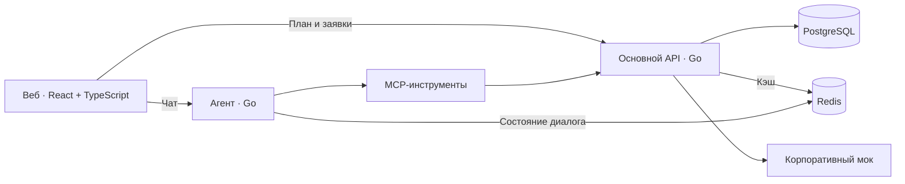

# AI-buddy

**Помощник стажёра в первые недели работы.** AI-buddy знает, на каком этапе адаптации находится сотрудник, находит инструкции его команды и помогает оформить отгул или запросить доступ. Стажёр видит параметры заявки и подтверждает отправку прямо в чате. Руководитель получает её на согласование.

[Быстрый старт](#быстрый-старт) · [Демо](#демо-за-две-минуты) · [Архитектура](#архитектура) · [Проверки](#проверки)

## Быстрый старт

Из корня репозитория запустите Docker Engine с Compose v2. Для первого запуска достаточно настроек по умолчанию.

```sh
docker compose up --build -d
docker compose ps
```

Откройте **[AI-buddy в браузере](http://127.0.0.1:3000)** и нажмите **«Войти как Анна»**. Миграции применяются автоматически, при первом запуске API создаёт демоданные. Команда `docker compose down` остановит приложение и сохранит базу в Docker volume.

> Демо работает без ключа модели. В режиме `LLM_PROVIDER=mock` агент ведёт диалог по сценариям, а API создаёт заявки в PostgreSQL. Корпоративные сервисы имитирует `corp-mock`. Пользователи и инструкции вымышлены.

## Демо за две минуты

1. **Откройте главную Анны.** Здесь видны наставник, прогресс и ближайшая задача. В чате спросите «Что мне делать дальше?».
2. **Спросите «Какие доступы мне нужны?».** Агент покажет, что уже выдано, что ждёт согласования и чего не хватает. На свежих демоданных Анне доступен запрос в Grafana.
3. **Выберите систему и подтвердите запрос.** В разделе «Мои заявки» появится заявка на согласовании. До подтверждения карточку можно отменить.
4. **Войдите как Елена.** Одобрите заявку Анны в разделе согласований. Вернитесь под Анной и проверьте статус в «Моих доступах».

| Ещё можно спросить | Что проверить в ответе |
| --- | --- |
| «Как у нас проходит код-ревью?» | Агент находит инструкцию и даёт ссылку на статью, доступную команде. |
| «Хочу взять отгул» | Агент уточняет даты и показывает карточку, в которой можно проверить или изменить параметры. |

<details>
<summary><strong>Все демо-аккаунты</strong></summary>

Общий пароль — `test1234`.

| Команда | Стажёры | Наставник | Руководитель |
| --- | --- | --- | --- |
| Доставка | `intern_anna`, `intern_boris` | `buddy_dmitry` | `lead_elena` |
| Фронтенд | `intern_vera` | — | `lead_fedor` |

</details>

## Архитектура



**Основной API** проверяет права по роли и команде при каждом обращении к защищённым данным. При повторной отправке заявки с тем же ключом и параметрами возвращается сохранённый результат. PostgreSQL хранит заявки, прогресс и счётчики попыток входа. Если Redis недоступен, вход, план и список доступов продолжают работать. [Контракт REST API](docs/openapi.yaml)

**Агент** передаёт ответы в чат потоком и вызывает инструменты с правами текущего пользователя. Для внешней модели скопируйте [.env.example](.env.example) в `.env`, установите `LLM_PROVIDER=openai` и задайте `LLM_BASE_URL`, `LLM_MODEL`, `LLM_API_KEY`. Затем выполните `docker compose up -d agent`. [Настройка агента](agent/README.md) · [События чата и карточки действий](docs/agent-api.md)

**Веб-интерфейс** обращается к API и агенту через nginx на том же адресе, с которого открыта страница. Для диагностики основного API доступен [эндпоинт готовности](http://127.0.0.1:8080/readyz). [Разработка интерфейса](web/README.md)

## Проверки

| Что проверить | Как запустить |
| --- | --- |
| Основной API с тестовыми PostgreSQL и Redis | Из корня — `make test` |
| Линтер основного API | Из корня — `make lint` |
| Агент и сценарии | Из `agent/` — `go test ./...` |
| Веб-интерфейс | Из `web/` — `npm ci`, затем `npm test`, `npm run lint` и `npm run build` |
| Весь путь от веб-прокси до корпоративного сервиса | На запущенном демо из корня — `python3 scripts/e2e_smoke.py`. Скрипт создаёт и согласует тестовые заявки. |

Для тестирования API без Make выполните `docker compose -p buddy-tests -f docker-compose.test.yml up --abort-on-container-exit --exit-code-from tests`. Чтобы восстановить исходное состояние демо, выполните `make seed`. Сброс удалит созданные демозаявки и переписку.

Тесты основного API, включая проверку отказа Redis, покрывают **81,1%** кода. В сценарном режиме агент прошёл **26 из 26** проверок. Результаты по ролям, сбоям и интерфейсу собраны в отчётах команды. [Отчёт QA](docs/qa-report.md) · [Результаты сценариев](evals/report.md)
